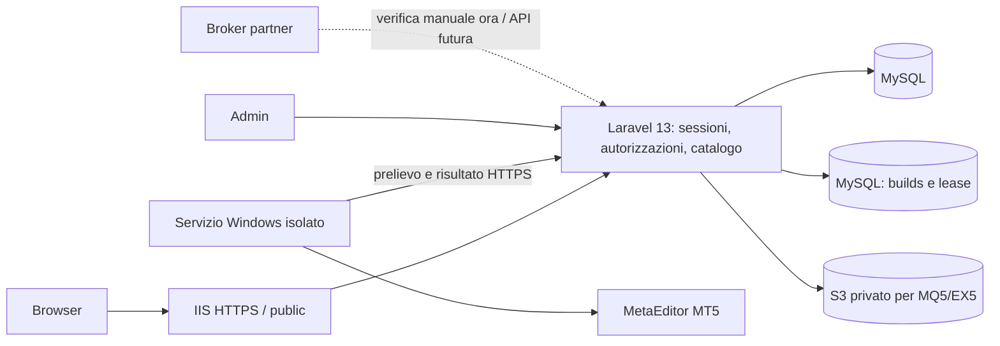

# EA Archive — architettura MVP

Ultimo aggiornamento: 18 novembre 2026.

## Ambito e decisioni

Database di riferimento: MySQL con InnoDB e utf8mb4, scelto dall'utente. Configurazione e passaggio dal database locale in [DATABASE.md](DATABASE.md).

Marketplace gratuito di Expert Advisor, in italiano. Utenti, sviluppatori abilitati da admin, amministratori. Prima versione: MetaTrader 5, MQ5 autonomi, una immagine per EA, verifica manuale dei conti. Nessun pagamento, nessuna promessa di rendimento. Il conto è assegnato dal broker: la registrazione al sito non crea un conto finanziario. L'integrazione API broker sarà implementata dopo aver ricevuto provider, documentazione e credenziali.

## Sistema



Monolite modulare, rendering server Blade e CSS senza toolchain frontend. Riduce costo operativo iniziale. Web stateless rispetto a file locali nella topologia distribuita: sessioni/cache su Redis, dati MySQL, file su storage condiviso privato. Il worker può essere spostato su host dedicati senza cambiare i flussi web. Non è una garanzia di supportare milioni di utenti senza misure, load test e adeguata infrastruttura.

Lo sviluppo locale usa SQLite, la produzione MySQL. La compilazione usa il servizio Windows esterno con polling HTTPS e assegnazioni transazionali nella tabella builds; non usa più la coda compilers di Laravel. Nuovi sorgenti e compilati possono risiedere su S3 privato; il disco è memorizzato per ogni record. Il servizio Windows non accede a MySQL o S3 direttamente. Immagini e altri file conservano il comportamento precedente. Vedi [EXTERNAL_SERVICES.md](EXTERNAL_SERVICES.md).

## Localizzazione e storage

Interfaccia italiano/inglese con helper Laravel, file JSON e PHP in lang/, lingua in sessione e users.locale, middleware SetLocale e selettore nel layout. Contenuti degli autori non tradotti automaticamente. Vedi [LOCALIZATION.md](LOCALIZATION.md).

La migrazione del 18 novembre aggiunge a experts disco/checksum sorgente e a builds disco/checksum artefatto, snapshot del sorgente, hash del token di assegnazione, scadenza e tentativi. L'utente ha confermato che non ci sono file EA pregressi da recuperare: il rilascio parte direttamente con S3. Il comando archive:copy-ea-storage resta opzionale per eventuali trasferimenti futuri; non va eseguito per questo passaggio.

## Schema database

| Tabella | Contenuto e vincoli |
|---|---|
| users | nome, email univoca, password hash, ruolo user/developer/admin, locale nullable it/en |
| brokers | nome, descrizione, URL affiliato HTTPS, immagine caricata privata oppure image_url HTTPS esterno, stato attivo e ordine; indice is_active+sort_order+id |
| broker_accounts | utente FK, login come stringa, server, stato pending/verified/rejected, verificatore FK; unico login+server |
| experts | autore FK, metadati strategia, versione, rischio dichiarato, percorsi privati sorgente/immagine; stato pending/published/rejected |
| builds | utente+EA+conto FK, queued/compiling/ready/failed, artefatto privato, errore generico, downloaded_at |
| reviews | utente+EA FK, voto 1–5, testo; unico utente+EA |
| audit_logs | amministratore FK, azione, soggetto, timestamp |
| jobs, failed_jobs | tabelle del framework; non usate dai nuovi lavori di compilazione |
| sessions, cache | stato condivisibile del framework |

Indici sullo stato catalogo e compilazioni, user+data compilazioni e vincoli univoci. Le transizioni amministrative sono transazionali e registrate. La richiesta build blocca la riga utente per evitare più compilazioni attive simultanee. Versioni EA immutabili: per ora ogni aggiornamento è una nuova pubblicazione. In futuro separare experts da expert_versions e registrare digest sorgente e compiler build.

## Superficie HTTP / API applicativa

L'MVP usa endpoint web con sessione e CSRF, non una API pubblica bearer-token. Per un client esterno aggiungere API versionata `/api/v1` con Sanctum, policies e risorse JSON senza duplicare le regole.

| Metodo | Endpoint | Accesso / comportamento |
|---|---|---|
| GET | / | pubblico, catalogo paginato, ricerca `q` |
| POST | /language | sessione/CSRF, cambio it/en e persistenza preferenza |
| GET | /experts/{id} | pubblico, solo EA pubblicati |
| GET | /experts/{id}/image | pubblico, immagine di EA pubblicato |
| GET/POST | /register | guest, registrazione, password minimo 12 caratteri |
| GET/POST | /login | guest, login limitato a 5/min |
| POST | /logout | autenticato, invalida sessione |
| GET/POST | /forgot-password | guest, richiesta recupero password senza enumerazione utenti |
| GET/POST | /reset-password | guest, reset con token monouso (GET con token nel percorso) |
| GET | /email/verify/{id}/{hash} | autenticato, URL firmato per verifica email |
| POST | /email/verification-notification | autenticato, reinvio con rate limit |
| GET | /account | autenticato, profilo/conti/storico propri |
| GET | /brokers | autenticato, schede broker attive ordinate e paginate |
| GET | /brokers/{broker}/image | autenticato, immagine broker attivo; admin anche nascosto |
| GET/POST | /admin/brokers | admin, elenco completo / creazione |
| GET | /admin/brokers/create | admin, form creazione |
| GET | /admin/brokers/{broker}/edit | admin, form modifica |
| PUT/DELETE | /admin/brokers/{broker} | admin, modifica / eliminazione con audit |
| POST | /profile | autenticato, modifica nome |
| POST | /broker-accounts | autenticato, invia conto per verifica |
| POST | /experts/{id}/builds | autenticato, conto proprio verificato, EA pubblicato |
| GET | /builds/{id}/download | proprietario, build pronta, conto ancora verificato |
| POST | /experts/{id}/reviews | autenticato, download precedente obbligatorio |
| GET | /developer | sviluppatore/admin, proprie pubblicazioni |
| POST | /developer/experts | sviluppatore/admin, multipart sorgente e immagine |
| GET | /admin | solo admin, gestione |
| GET | /admin/experts/{id}/source | solo admin, sorgente per revisione |
| POST | /admin/moderate | solo admin; type=role/account/expert, id, value |
| GET | /up | health Laravel |

Le mutazioni restituiscono redirect ed errori validazione nella UI; accessi non autorizzati 403, risorse di altri utenti 404. I campi ruolo/stato non vengono accettati dai form pubblici. L'amministratore si crea solo da CLI.

Per il servizio Windows sono presenti quattro endpoint autenticati `/api/v1/compiler`: claim, source, complete e fail. Il loro contratto e i requisiti di rete sono descritti in [EXTERNAL_SERVICES.md](EXTERNAL_SERVICES.md).

## Architettura UI

Pagina **Scegli il broker** raggiungibile dal menu e dal profilo, con immagine, descrizione e link affiliato di ogni broker attivo. La console amministrativa collega la gestione delle schede, dell'ordine e della visibilità. La registrazione avviene sul sito esterno del broker; la verifica conto rimane separata e manuale. Dettagli in [BROKERS.md](BROKERS.md).

Layout condiviso con sidebar e intestazione adattive. Catalogo con ricerca, schede, strategia, simboli, timeframe e rischio. Dettaglio con immagine, descrizione, recensioni e richiesta compilazione. Workspace con profilo, collegamento conto e stato build. Studio con form sorgente e stato moderazione. Console amministrativa con ruoli, verifica conti, download sorgenti e approvazione. Nessun dato di rendimento inventato o backtest presentato come reale. Stati vuoti espliciti.

## Struttura file

```text
app/Http/Controllers/ArchiveController.php  flussi web e autorizzazioni
app/Http/Controllers/BrokerController.php   lista broker e CRUD amministrativo
app/Jobs/CompileExpert.php                 handler innocuo per vecchi job
app/Models/User.php                       identità e hashing
config/archive.php                        lingue, disco EA e protocollo compilatore
database/migrations/                      schema e indici
database/seeders/                          catalogo dimostrativo locale
resources/views/                          layout e pagine Blade
resources/views/brokers/                  lista utenti e gestione broker
routes/web.php                            endpoint con auth/CSRF/throttling
routes/console.php                        bootstrap amministratore
public/app.css                            UI responsive
public/ea-template.mq5                     contratto sorgente
public/web.config                         rewrite IIS
storage/app/private/                      immagini e file EA storici/locali (mai pubblici)
lang/                                     traduzioni Laravel it/en
services/windows-compiler/                 servizio esterno Python e template WinSW
routes/api.php                            API token-based del servizio
app/Console/Commands/CopyEaStorage.php     migrazione file verso storage privato
tests/Feature/ArchiveTest.php              accesso, licenze e recensioni
docs/                                     architettura e deployment
```

## Pipeline EA e limiti di sicurezza

1. Lo sviluppatore carica il sorgente sul disco EA configurato, senza accesso pubblico; disco, percorso e SHA-256 vengono registrati.
2. L'amministratore verifica manualmente sorgente, contratto EA_OnInit/EA_OnTick e conto del broker.
3. L'utente richiede la compilazione. Laravel crea un record queued, senza eseguire MetaEditor.
4. Il servizio Windows preleva un lavoro via HTTPS con token globale. Laravel assegna una lease di 600 secondi e un token per lavoro, conservandone solo l'hash.
5. Il servizio scarica il sorgente, verifica il checksum quando disponibile, aggiunge il controllo di login e server ed esegue MetaEditor in directory temporanea. Timeout del processo 120 secondi. Nessun EX5 viene eseguito dal servizio.
6. Il servizio invia EX5 e checksum. Laravel controlla lease, conto, stato EA, file e checksum, e salva il risultato sullo storage privato. Completamento ripetuto identico idempotente; vecchi token rifiutati.
7. Il download resta autorizzato al proprietario. Sorgenti accessibili solo all'admin e al servizio per il lavoro assegnato.

La revisione umana e l'isolamento Windows restano necessari. Il wrapper non è un sandbox e non garantisce protezione assoluta contro un autore ostile o reverse engineering. Un file già scaricato non viene revocato dal cambio di stato del conto sul sito. I dettagli del contratto, i limiti e il passaggio dalla vecchia versione sono in [EXTERNAL_SERVICES.md](EXTERNAL_SERVICES.md).

## Crescita

Misurare latenza, errori, durata coda, failure rate e spazio disco. Espandere web pool, Redis, object storage e worker isolati separatamente. Cache catalogo/CDN immagini pubbliche; non cache artefatti privati. Aggiungere versionamento, dedup build per versione/conto, ricerca dedicata solo con volumi misurati. Prima di crescita massiva: restore test backup, disaster recovery, load test, osservabilità e revisione delle policy di conservazione dati.

Fonti tecniche: [Laravel 13 deployment](https://laravel.com/docs/13.x/deployment), [MetaEditor CLI](https://www.metatrader5.com/en/metaeditor/help/beginning/integration_ide), [MQL5 AccountInfoInteger](https://www.mql5.com/en/docs/account/accountinfointeger).
