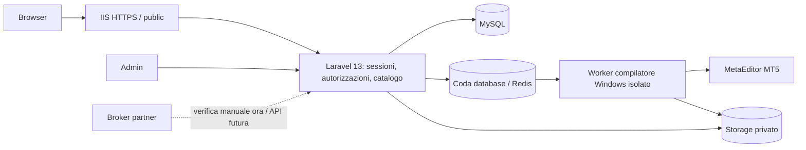

# EA Archive — architettura MVP

Ultimo aggiornamento: 17 novembre 2026.

## Ambito e decisioni

Database di riferimento: MySQL con InnoDB e utf8mb4, scelto dall'utente. Configurazione e passaggio dal database locale in [DATABASE.md](DATABASE.md).

Marketplace gratuito di Expert Advisor, in italiano. Utenti, sviluppatori abilitati da admin, amministratori. Prima versione: MetaTrader 5, MQ5 autonomi, una immagine per EA, verifica manuale dei conti. Nessun pagamento, nessuna promessa di rendimento. Il conto è assegnato dal broker: la registrazione al sito non crea un conto finanziario. L'integrazione API broker sarà implementata dopo aver ricevuto provider, documentazione e credenziali.

## Sistema



Monolite modulare, rendering server Blade e CSS senza toolchain frontend. Riduce costo operativo iniziale. Web stateless rispetto a file locali nella topologia distribuita: sessioni/cache su Redis, dati MySQL, file su storage condiviso privato. Il worker può essere spostato su host dedicati senza cambiare i flussi web. Non è una garanzia di supportare milioni di utenti senza misure, load test e adeguata infrastruttura.

Il prototipo locale usa SQLite e coda database; produzione iniziale: MySQL, backup e storage privato condiviso. Nessun compilatore sul processo web. Non avviare il worker nella stessa identità privilegiata di IIS. Al momento il job usa il disco `local`: distribuendo più host, questo deve diventare un volume privato condiviso oppure un adapter object storage con download/upload temporanei sul worker.

## Schema database

| Tabella | Contenuto e vincoli |
|---|---|
| users | nome, email univoca, password hash, ruolo user/developer/admin |
| brokers | nome, descrizione, URL affiliato HTTPS, immagine privata, stato attivo e ordine; indice is_active+sort_order+id |
| broker_accounts | utente FK, login come stringa, server, stato pending/verified/rejected, verificatore FK; unico login+server |
| experts | autore FK, metadati strategia, versione, rischio dichiarato, percorsi privati sorgente/immagine; stato pending/published/rejected |
| builds | utente+EA+conto FK, queued/compiling/ready/failed, artefatto privato, errore generico, downloaded_at |
| reviews | utente+EA FK, voto 1–5, testo; unico utente+EA |
| audit_logs | amministratore FK, azione, soggetto, timestamp |
| jobs, failed_jobs | coda persistente e fallimenti del framework |
| sessions, cache | stato condivisibile del framework |

Indici sullo stato catalogo e compilazioni, user+data compilazioni e vincoli univoci. Le transizioni amministrative sono transazionali e registrate. La richiesta build blocca la riga utente per evitare più compilazioni attive simultanee. Versioni EA immutabili: per ora ogni aggiornamento è una nuova pubblicazione. In futuro separare experts da expert_versions e registrare digest sorgente e compiler build.

## Superficie HTTP / API applicativa

L'MVP usa endpoint web con sessione e CSRF, non una API pubblica bearer-token. Per un client esterno aggiungere API versionata `/api/v1` con Sanctum, policies e risorse JSON senza duplicare le regole.

| Metodo | Endpoint | Accesso / comportamento |
|---|---|---|
| GET | / | pubblico, catalogo paginato, ricerca `q` |
| GET | /experts/{id} | pubblico, solo EA pubblicati |
| GET | /experts/{id}/image | pubblico, immagine di EA pubblicato |
| GET/POST | /register | guest, registrazione, password minimo 12 caratteri |
| GET/POST | /login | guest, login limitato a 5/min |
| POST | /logout | autenticato, invalida sessione |
| GET/POST | /forgot-password | guest, richiesta recupero password senza enumerazione utenti |
| GET/POST | /reset-password | guest, reset con token monouso (GET con token nel percorso) |
| GET | /email/verify/{id}/{hash} | autenticato, URL firmato per verifica email |
| POST | /email/verification-notification | autenticato, reinvio con rate limit |
| GET | /account | autenticato, profilo/conti/storico propri |
| GET | /brokers | autenticato, schede broker attive ordinate e paginate |
| GET | /brokers/{broker}/image | autenticato, immagine broker attivo; admin anche nascosto |
| GET/POST | /admin/brokers | admin, elenco completo / creazione |
| GET | /admin/brokers/create | admin, form creazione |
| GET | /admin/brokers/{broker}/edit | admin, form modifica |
| PUT/DELETE | /admin/brokers/{broker} | admin, modifica / eliminazione con audit |
| POST | /profile | autenticato, modifica nome |
| POST | /broker-accounts | autenticato, invia conto per verifica |
| POST | /experts/{id}/builds | autenticato, conto proprio verificato, EA pubblicato |
| GET | /builds/{id}/download | proprietario, build pronta, conto ancora verificato |
| POST | /experts/{id}/reviews | autenticato, download precedente obbligatorio |
| GET | /developer | sviluppatore/admin, proprie pubblicazioni |
| POST | /developer/experts | sviluppatore/admin, multipart sorgente e immagine |
| GET | /admin | solo admin, gestione |
| GET | /admin/experts/{id}/source | solo admin, sorgente per revisione |
| POST | /admin/moderate | solo admin; type=role/account/expert, id, value |
| GET | /up | health Laravel |

Le mutazioni restituiscono redirect ed errori validazione nella UI; accessi non autorizzati 403, risorse di altri utenti 404. I campi ruolo/stato non vengono accettati dai form pubblici. L'amministratore si crea solo da CLI.

## Architettura UI

Pagina **Scegli il broker** raggiungibile dal menu e dal profilo, con immagine, descrizione e link affiliato di ogni broker attivo. La console amministrativa collega la gestione delle schede, dell'ordine e della visibilità. La registrazione avviene sul sito esterno del broker; la verifica conto rimane separata e manuale. Dettagli in [BROKERS.md](BROKERS.md).

Layout condiviso con sidebar e intestazione adattive. Catalogo con ricerca, schede, strategia, simboli, timeframe e rischio. Dettaglio con immagine, descrizione, recensioni e richiesta compilazione. Workspace con profilo, collegamento conto e stato build. Studio con form sorgente e stato moderazione. Console amministrativa con ruoli, verifica conti, download sorgenti e approvazione. Nessun dato di rendimento inventato o backtest presentato come reale. Stati vuoti espliciti.

## Struttura file

```text
app/Http/Controllers/ArchiveController.php  flussi web e autorizzazioni
app/Http/Controllers/BrokerController.php   lista broker e CRUD amministrativo
app/Jobs/CompileExpert.php                 job compilazione
app/Models/User.php                       identità e hashing
config/archive.php                        broker e compilatore
database/migrations/                      schema e indici
database/seeders/                          catalogo dimostrativo locale
resources/views/                          layout e pagine Blade
resources/views/brokers/                  lista utenti e gestione broker
routes/web.php                            endpoint con auth/CSRF/throttling
routes/console.php                        bootstrap amministratore
public/app.css                            UI responsive
public/ea-template.mq5                     contratto sorgente
public/web.config                         rewrite IIS
storage/app/private/                      sorgenti, immagini, artefatti (mai pubblici)
tests/Feature/ArchiveTest.php              accesso, licenze e recensioni
docs/                                     architettura e deployment
```

## Pipeline EA e limiti di sicurezza

1. Sviluppatore carica MQ5 privato e metadati. Nessuna compilazione automatica prima della revisione.
2. Admin scarica e revisiona il sorgente, controllando include, macro, DLL, altri eventi (timer, trade, chart), chiamate a trading fuori dai due entrypoint e ogni modo di alterare il wrapper. Pubblica solo sorgenti autonomi compatibili.
3. Admin verifica proprietà del conto e collegamento al broker partner con riscontro esterno. Non basta un numero dichiarato dall'utente.
4. Utente richiede build legata a conto e server. Job aggiunge `OnInit` e `OnTick` che verificano `ACCOUNT_LOGIN` e `ACCOUNT_SERVER`, invocando `EA_OnInit` e `EA_OnTick`.
5. MetaEditor compila in directory casuale; artefatto accettato solo con file EX5 e log con zero errori. Cleanup in finally. Errori pubblici generici; log interni senza sorgenti.
6. Download autorizzato lato server e privato, mai link pubblico al disco. Non distribuire MQ5.

Il wrapper non è un sandbox, né una protezione assoluta contro reverse engineering o uno sviluppatore ostile. Prima di aprire upload a terzi servono worker Windows effimeri, account OS dedicato senza privilegi, rete bloccata salvo risorse necessarie, limiti CPU/disco/processi, scansione e revisione sorgenti. Il codice non crea automaticamente questo isolamento. Revocare il conto impedisce nuovi download, ma non revoca un EX5 già consegnato: per revoca a runtime serve un servizio licenze online e una gestione esplicita dei periodi offline.

## Crescita

Misurare latenza, errori, durata coda, failure rate e spazio disco. Espandere web pool, Redis, object storage e worker isolati separatamente. Cache catalogo/CDN immagini pubbliche; non cache artefatti privati. Aggiungere versionamento, dedup build per versione/conto, ricerca dedicata solo con volumi misurati. Prima di crescita massiva: restore test backup, disaster recovery, load test, osservabilità e revisione delle policy di conservazione dati.

Fonti tecniche: [Laravel 13 deployment](https://laravel.com/docs/13.x/deployment), [MetaEditor CLI](https://www.metatrader5.com/en/metaeditor/help/beginning/integration_ide), [MQL5 AccountInfoInteger](https://www.mql5.com/en/docs/account/accountinfointeger).
