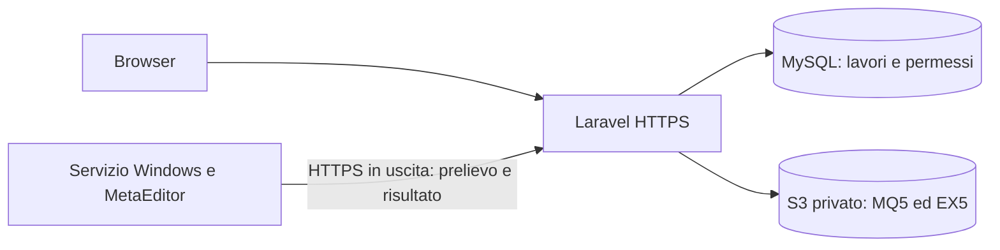

# Compilazione Windows e storage esterni

Ultimo aggiornamento: 18 novembre 2026.

Questa implementazione sostituisce la compilazione MetaEditor nel job Laravel. Il codice è sviluppato localmente, non ancora pubblicato o collegato a un bucket/server Windows reale. L'utente ha confermato italiano/inglese e storage compatibile S3.

## Architettura



Il servizio Windows non riceve connessioni in ingresso e non accede a MySQL o direttamente a S3. Non necessita quindi di credenziali database o bucket. Laravel trasferisce i file in streaming attraverso l'API; questa scelta mantiene l'autorizzazione centralizzata. La successiva evoluzione a trasferimenti S3 firmati può ridurre il traffico web, ma non fa parte di questa versione.

## Storage

Il 18 novembre 2026 l'utente ha confermato che non esistono sorgenti o compilati locali pregressi da recuperare. Lo storage S3 parte vuoto: non serve trasferire file o eseguire il comando di copia per questo rilascio. Questa precisazione riguarda i file EA, non autorizza la cancellazione del database, delle immagini o di altri dati.

`EA_FILESYSTEM_DISK` seleziona il disco dei nuovi sorgenti e dei nuovi compilati. In produzione impostare `s3`; `local` resta disponibile per sviluppo. Immagini EA e broker mantengono il loro attuale disco e non vengono migrate da questo intervento.

```dotenv
EA_FILESYSTEM_DISK=s3
AWS_ACCESS_KEY_ID=credenziale-da-inserire-sul-server
AWS_SECRET_ACCESS_KEY=segreto-da-inserire-sul-server
AWS_DEFAULT_REGION=us-east-1
AWS_BUCKET=nome-bucket-privato
AWS_ENDPOINT=https://endpoint-del-fornitore
AWS_USE_PATH_STYLE_ENDPOINT=false
COMPILER_API_TOKEN=token-casuale-di-almeno-32-caratteri
```

Le credenziali qui sono segnaposto. Configurare endpoint, regione e path-style secondo il provider. Per AWS nativo lasciare l'endpoint vuoto. Il bucket deve vietare l'accesso pubblico; non creare collegamenti pubblici ai file EA. Usare cifratura, backup/versionamento e credenziali limitate al bucket dedicato. Il disco `s3` genera errori espliciti in caso di scrittura fallita. Il pacchetto `league/flysystem-aws-s3-v3` è incluso nelle dipendenze di produzione.

Ogni EA conserva `source_disk`, `source_path` e `source_sha256`; ogni risultato conserva `artifact_disk`, `artifact_path` e `artifact_sha256`. I record esistenti hanno disco `local`: cambiare configurazione non rende inaccessibili i file vecchi. Download sempre autorizzati lato Laravel, senza esporre il sorgente all'utente finale.

## Protocollo API v1

Tutte le richieste richiedono HTTPS e `Authorization: Bearer <COMPILER_API_TOKEN>`. Il token deve essere casuale, lungo almeno 32 caratteri, conservato separatamente sul sito e sul servizio. Nessuna sessione utente abilita questi endpoint. Rate limit 120 richieste/minuto per IP: non è una quota per singolo worker. Configurare TLS al proxy/web server e l'eventuale allowlist di rete per i worker.

| Metodo | Endpoint | Payload / risultato |
|---|---|---|
| POST | `/api/v1/compiler/claim` | JSON `{}`; restituisce `build: null` oppure id, token di assegnazione, login, server, checksum sorgente, scadenza e protocol=1 |
| GET | `/api/v1/compiler/builds/{id}/source` | richiede `X-Build-Token`; restituisce il MQ5 del lavoro |
| POST | `/api/v1/compiler/builds/{id}/complete` | richiede `X-Build-Token`; multipart `artifact` EX5 fino a 16 MB e `sha256` |
| POST | `/api/v1/compiler/builds/{id}/fail` | richiede `X-Build-Token`; nessun errore/sorgente del worker viene salvato nel messaggio pubblico |

Il token globale identifica il servizio autorizzato; il token casuale per lavoro limita lettura e completamento all'assegnazione corrente. Nel DB viene conservato solo l'hash del secondo token. La selezione del lavoro usa transazione e lock. L'assegnazione dura 600 secondi, il processo MetaEditor ha timeout 120 secondi. Un nuovo prelievo recupera le assegnazioni scadute, con massimo tre tentativi, e anche i vecchi lavori `compiling` senza lease dopo lo spegnimento del worker precedente.

Token errato: 401/403; lavoro scaduto o stato non compatibile: 409; payload/checksum errato: 422; token servizio non configurato: 503. I vecchi token non possono completare lavori riassegnati. Ripetere un completamento già accettato con lo stesso checksum è idempotente e non crea un secondo artefatto. Il conto verificato e la pubblicazione dell'EA sono ricontrollati prima di fornire sorgente o accettare il risultato.

I lavori con sorgente mancante, conto non verificato o EA non pubblicato falliscono senza compilazione. Se il servizio non è disponibile, i nuovi lavori restano in coda; non vengono prodotti file fittizi. La chiusura delle assegnazioni scadute avviene al successivo prelievo: non c'è un watchdog indipendente.

## Installazione servizio Windows

Cartella del codice: `services/windows-compiler/`. Sono presenti `worker.py`, test standard-library e un esempio WinSW `service.example.xml`. Non richiede pacchetti Python esterni. Usare Python compatibile con il codice (esempio 3.13) e un'installazione dedicata di MetaEditor MT5.

1. Preparare una macchina Windows isolata; non usare il web server. Creare un account di servizio senza privilegi amministrativi, con accesso solo a MetaEditor e alla cartella temporanea dedicata.
2. Copiare `worker.py` in `C:/EACompiler`. Configurare `EA_API_URL` (origine HTTPS del sito), `COMPILER_API_TOKEN`, `METAEDITOR_PATH` e facoltativamente `EA_WORK_DIRECTORY`.
3. Consentire al servizio rete in uscita verso il sito; bloccare l'accesso ai dati e servizi non necessari. Il token non deve essere disponibile agli utenti del sito.
4. Per avvio interattivo di collaudo eseguire `python C:/EACompiler/worker.py` con le variabili impostate nell'ambiente. Il polling è ogni 5 secondi quando non ci sono lavori.
5. Per installazione come servizio usare WinSW, verificandone provenienza/versione. Copiare l'esempio XML e adattare percorsi e origine al deployment. Fornire il token nell'ambiente effettivo del servizio o nel suo file XML locale protetto da ACL; non inserirlo nel repository. Configurare l'account dedicato tramite gestione servizi, non eseguire il compilatore come LocalSystem. Installare e avviare secondo il manuale della versione WinSW scelta.
6. Testare un EA revisionato su conto demo: numero e server corretti devono inizializzare l'EA, quelli diversi devono fallire. Testare timeout, riavvio del servizio e rifiuto di un vecchio token. Il modello XML è un esempio, non un servizio già installato.

Non registrare token, MQ5 o log completi del compilatore nei log centralizzati. L'agente registra ID lavoro e tipo di errore, senza includere contenuto sorgente. Ogni compilazione usa una cartella temporanea casuale eliminata al termine; i residui dei crash della macchina richiedono pulizia operativa dopo aver verificato che non siano lavori attivi.

## Contratto e limiti EA

Sono supportati MQ5 autonomi revisionati, con `int EA_OnInit()` e `void EA_OnTick()`. Il worker aggiunge `OnInit` e `OnTick` con controllo congiunto di `ACCOUNT_LOGIN` e `ACCOUNT_SERVER`. Rifiuta include, import, macro e direttive diverse da `#property`, oltre ad altri eventi `On...`. Il file deve essere UTF-8 (anche BOM) o UTF-16 con BOM. Il template pubblico non effettua trading.

Questo controllo non sostituisce la revisione umana né costituisce un sandbox. Un compilatore esposto a sorgenti ostili richiede isolamento OS/VM, limiti risorse e aggiornamenti. Un EX5 già scaricato non viene revocato quando si revoca il conto nel sito: per questo occorrerebbe un servizio licenze online. Supporto MT4 e pacchetti con dipendenze non implementati.

## Aggiornamento della versione pubblicata

1. Fare backup di database e file. Mettere il sito in manutenzione per il cambio di versione e fermare il vecchio worker `queue:work --queue=compilers` prima di avviare l'agente esterno. Non eseguire insieme vecchio e nuovo protocollo.
2. Distribuire codice e dipendenze con `composer install --no-dev --optimize-autoloader`, conservando APP_KEY e segreti esistenti.
3. Eseguire `php artisan migrate --force`: aggiunge lingua, dischi, checksum e assegnazioni senza cancellare dati. La vecchia classe job resta come handler innocuo per i messaggi eventualmente rimasti; i nuovi lavori non vengono più inviati alla coda Laravel.
4. Configurare S3 e token. Per completamenti fino a 16 MB, impostare PHP `upload_max_filesize` almeno `16M`, `post_max_size` almeno `20M` e limite IIS/proxy coerente. Non usare il vecchio limite di 4 MB per questo endpoint.
5. Impostare direttamente `EA_FILESYSTEM_DISK=s3` su un bucket privato vuoto. Non ci sono file EA pregressi da trasferire: saltare il comando di copia.
6. Ricostruire cache configurazione/viste, avviare il servizio esterno, eseguire smoke test e togliere la manutenzione. La migrazione del codice applicativo non installa il servizio Windows o crea il bucket.

### Comando opzionale, non necessario per questo rilascio

Il comando rimane disponibile come strumento tecnico per eventuali trasferimenti futuri; non fa parte della procedura corrente.

```powershell
# Anteprima, senza modifiche:
php artisan archive:copy-ea-storage s3
# Copia e verifica SHA-256 prima di aggiornare ciascun riferimento DB:
php artisan archive:copy-ea-storage s3 --apply
```

Il comando conserva tutti gli originali, si può riprendere dopo un'interruzione e rifiuta oggetti già presenti con contenuto differente. Può aggiornare una parte dei riferimenti prima di un errore: entrambi i dischi devono restare configurati. Le assegnazioni attive conservano lo snapshot del proprio sorgente; eseguire il passaggio con i worker fermi. La rimozione degli originali va pianificata separatamente dopo backup e verifica.

Per il rollback, ripristinare la versione applicativa e il backup coerente di configurazione/riferimenti: il vecchio compilatore non legge S3. Non effettuare automaticamente il rollback della migrazione con nuovi dati in uso.

## Verifiche

API, storage e migrazione sono testati con database SQLite in memoria e fake del disco S3. Test Python verificano wrapper, contratto, checksum, invocazione MetaEditor simulata e cleanup. Nessuna compilazione MetaEditor reale, connessione S3 reale, installazione WinSW o collaudo MySQL remoto eseguiti. Questi sono necessari prima del rilascio in produzione.

Riferimenti: [filesystem Laravel](https://laravel.com/docs/13.x/filesystem), [MetaEditor come compilatore esterno](https://www.metatrader5.com/en/metaeditor/help/beginning/integration_ide).
